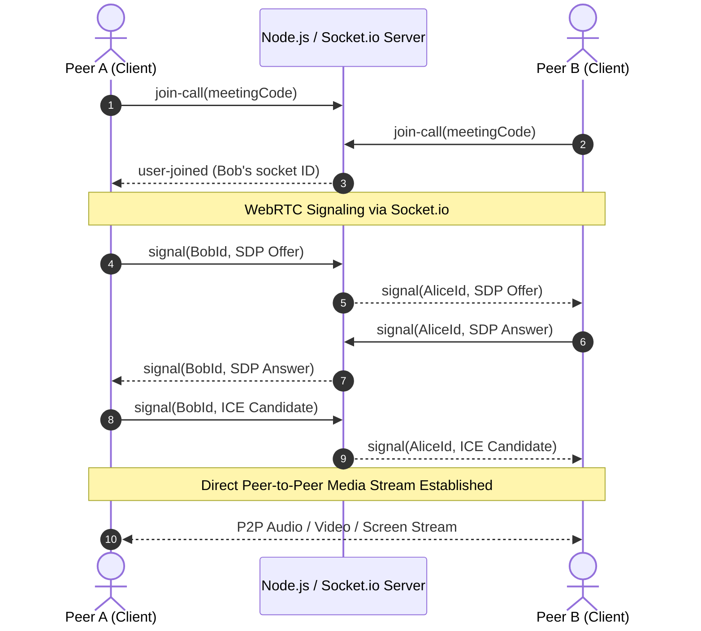

# 📹 Voila - Video Conferencing Platform

A full-stack, real-time video conferencing web application built with **React**, **Node.js**, **Express**, **Socket.io**, **WebRTC**, and **MongoDB**. Supports peer-to-peer video/audio calling, screen sharing, in-meeting live text chat, user authentication, and meeting history tracking.

---

## 🚀 Features

- **📹 High-Definition Video & Audio Calling**: Direct peer-to-peer media streaming powered by WebRTC with Google STUN servers.
- **🖥️ Screen Sharing**: In-call screen and application window sharing via HTML5 `getDisplayMedia`.
- **💬 Real-Time In-Meeting Chat**: Instant room-based messaging between participants using Socket.io.
- **🔒 User Authentication**: Secure registration and login with `bcrypt` password hashing and token-based session management.
- **📜 Meeting History**: View timestamped logs of past meetings linked to your account.
- **🎛️ In-Call Media Controls**: One-click toggles for microphone mute/unmute, camera on/off, screen share, and leave call.
- **🚪 Room-Based Meetings**: Join instantly via unique meeting codes or URLs (e.g., `/:meetingCode`).
- **🎨 Modern Responsive UI**: Styled with Material-UI (MUI) and custom CSS modules.

---

## 🛠️ Tech Stack

### Frontend
- **Framework**: React 18 (SPA)
- **Routing**: React Router v6
- **UI Components & Icons**: Material-UI (MUI) & `@mui/icons-material`
- **Real-Time Client**: `socket.io-client`
- **HTTP Client**: `axios`
- **Hosting**: Vercel

### Backend
- **Runtime**: Node.js (ES Modules)
- **Web Framework**: Express.js
- **Signaling & WebSockets**: Socket.io
- **Database & ODM**: MongoDB with Mongoose
- **Security**: `bcrypt` (password hashing), `crypto` (secure token generation), `cors`
- **Hosting**: Render

### Networking & Protocols
- **WebRTC**: `RTCPeerConnection` (SDP Offers/Answers, ICE candidates)
- **STUN Server**: `stun:stun.l.google.com:19302`
- **WebSockets**: Real-time bidirectional event-driven communication

---

## 📐 Architecture & WebRTC Flow



---

## 📁 Project Structure

```text
Video/
├── backend/
│   ├── src/
│   │   ├── controllers/
│   │   │   ├── socketManager.js       # Socket.io connection, rooms & WebRTC signaling
│   │   │   └── user.controller.js     # Auth & meeting history handlers
│   │   ├── models/
│   │   │   ├── meeting.model.js       # Meeting history schema
│   │   │   └── user.model.js          # User account schema
│   │   ├── routes/
│   │   │   └── users.routes.js        # Auth and history API routes
│   │   └── app.js                     # Express app & HTTP/Socket server entry point
│   ├── package.json
│   └── .gitignore
├── frontend/
│   ├── public/                        # Static assets (favicons, icons, manifest)
│   ├── src/
│   │   ├── contexts/
│   │   │   └── AuthContext.jsx        # Global authentication state provider
│   │   ├── pages/
│   │   │   ├── authentication.jsx     # Login & Signup forms
│   │   │   ├── history.jsx            # User meeting history view
│   │   │   ├── home.jsx               # Dashboard to join/create meetings
│   │   │   ├── landing.jsx            # Landing page
│   │   │   └── VideoMeet.jsx          # WebRTC video room & chat interface
│   │   ├── styles/
│   │   │   └── videoComponent.module.css
│   │   ├── utils/
│   │   │   └── withAuth.jsx           # Route protection HOC
│   │   ├── App.js                     # Route declarations
│   │   ├── environment.js             # API / Backend URL switcher
│   │   └── index.js
│   ├── vercel.json                    # SPA rewrite rule for Vercel
│   ├── package.json
│   └── .gitignore
├── .gitignore
└── README.md
```

---

## 📡 REST API Reference

Base URL: `http://localhost:8000/api/v1/users` (or production Render URL)

| Method | Endpoint | Description | Payload / Query |
| :--- | :--- | :--- | :--- |
| `POST` | `/register` | Register a new user | `{ "name": "...", "username": "...", "password": "..." }` |
| `POST` | `/login` | Authenticate user & receive token | `{ "username": "...", "password": "..." }` |
| `POST` | `/add_to_activity` | Add meeting code to user history | `{ "token": "...", "meeting_code": "..." }` |
| `GET` | `/get_all_activity` | Retrieve all past meetings for user | Query param: `?token=<user_token>` |

---

## ⚡ Socket.io Events

| Event Name | Direction | Payload | Description |
| :--- | :--- | :--- | :--- |
| `join-call` | Client ➔ Server | `meetingCode` | Joins a meeting room |
| `user-joined` | Server ➔ Client | `(socketId, connections)` | Broadcasts when a peer joins |
| `signal` | Bidirectional | `(toId, message)` | Relays SDP offers, answers & ICE candidates |
| `chat-message` | Bidirectional | `(data, sender, socketId)` | Broadcasts in-call chat messages to room |
| `user-left` | Server ➔ Client | `socketId` | Alerts when a participant disconnects |

---

## ⚙️ Environment Variables

### Backend (`backend/.env` or Render)
```env
PORT=8000
MONGO_URI=mongodb+srv://<username>:<password>@cluster0.example.mongodb.net/video_db?retryWrites=true&w=majority
```

### Frontend (`frontend/.env` or Vercel)
```env
REACT_APP_BACKEND_URL=https://your-backend-service.onrender.com
```

---

## 💻 Local Setup & Installation

### Prerequisites
- [Node.js](https://nodejs.org/) (v16 or higher)
- [npm](https://www.npmjs.com/)
- [MongoDB](https://www.mongodb.com/) (Local instance or free MongoDB Atlas cluster)

### 1. Clone the Repository
```bash
git clone <your-repository-url>
cd Video
```

### 2. Setup & Run Backend
```bash
cd backend
npm install
npm run dev
# Server will start on http://localhost:8000
```

### 3. Setup & Run Frontend
In a new terminal:
```bash
cd frontend
npm install
npm start
# App will open at http://localhost:3000
```

---

## 🚀 Deployment Guide

### Backend on Render
1. Create a new **Web Service** on [Render](https://render.com).
2. Connect your GitHub repository.
3. Configure settings:
   - **Root Directory**: `backend`
   - **Runtime**: `Node`
   - **Build Command**: `npm install`
   - **Start Command**: `npm start`
4. Add environment variable `MONGO_URI` with your MongoDB connection string.
5. Deploy and copy your Render URL (e.g., `https://your-backend.onrender.com`).

### Frontend on Vercel
1. Import the same repository into [Vercel](https://vercel.com).
2. Configure settings:
   - **Root Directory**: `frontend`
   - **Framework Preset**: `Create React App`
3. Add environment variable:
   - `REACT_APP_BACKEND_URL` = `https://your-backend.onrender.com`
4. Deploy! The included `frontend/vercel.json` ensures client-side routing works without 404s.

---

## 📄 License

This project is open-source and available under the [ISC License](LICENSE).
